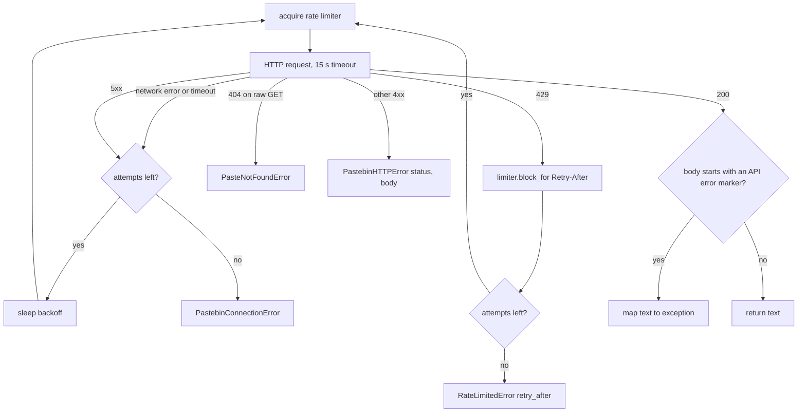
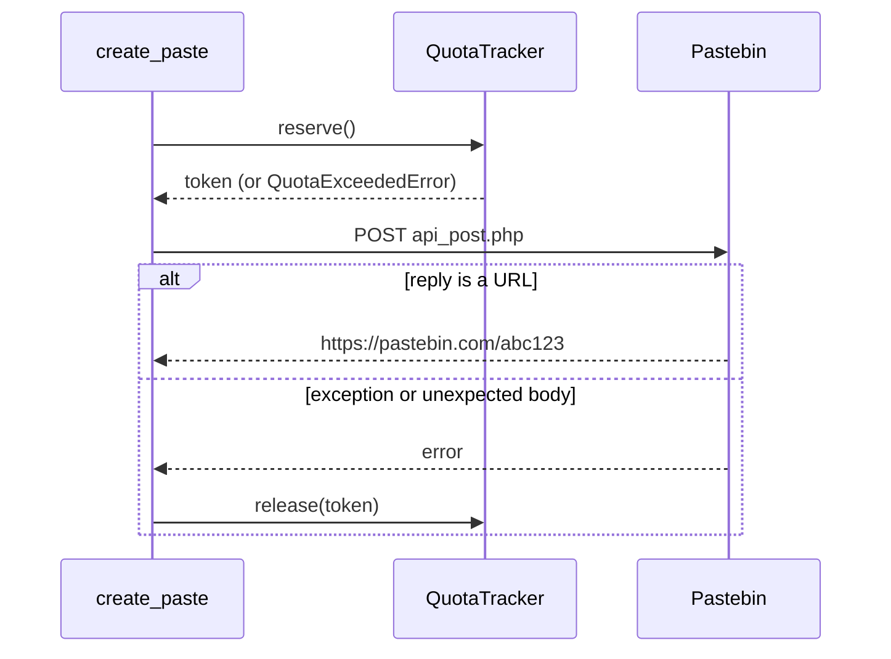

# Pastebin Client

`PastebinClient` is an async, rate-limited wrapper around the [Pastebin API](https://pastebin.com/doc_api) built on `aiohttp`. It exists so the bot can hand long output (logs, dumps, reports) to a paste instead of fighting Discord's 2000-character limit.

It never blocks the event loop, it throttles itself so several commands can share one client safely, and it turns Pastebin's quirky "errors as `200 OK` plain text" replies into a proper exception hierarchy.

Everything lives in `__init__.py`; `core.utils` re-exports `PastebinClient`.

## Status in this bot

The client is implemented and exported but **not wired up yet**: nothing in `core/` or `extensions/` constructs it. The key already lives in `.env` as `PASTEBIN_API_KEY` (also listed in `.example-env`).

The intended wiring is one client per bot, sharing the bot's HTTP session:

```python
# core/bot.py, inside setup_hook()
self.pastebin = PastebinClient(
    os.environ["PASTEBIN_API_KEY"],
    session=self.http_session,
    default_expiry=Expiry.ONE_WEEK,
)
```

Passing `session=` means `close()` leaves the session alone, because the bot owns it. Without `session=` the client lazily creates its own `aiohttp.ClientSession` and closes it in `close()`.

A command then does:

```python
if fits_in_discord(text):
    await ctx.reply(text)
else:
    paste = await ctx.bot.pastebin.create_paste(text, title="Report", syntax="text")
    await ctx.reply(view=NoticeLayout.info(f"Output was too long for Discord: {paste.url}"))
```

## Public surface

| Name | Kind | Purpose |
| --- | --- | --- |
| `PastebinClient` | class | The client. Async context manager (`async with`), or call `close()` yourself. |
| `create_paste(content, *, title, syntax, visibility, expiry)` | coroutine | Create a paste, return a `Paste`. |
| `get_raw(paste)` | coroutine | Fetch a paste's text by `Paste`, key or URL. |
| `list_pastes(limit=50)` | coroutine | The logged-in user's pastes, newest first (`limit` 1 to 1000). |
| `delete_paste(paste)` | coroutine | Delete one of the logged-in user's pastes. |
| `login()` | coroutine | Exchange username/password for a user key. Called lazily; rarely needed directly. |
| `remaining_quota` | property | Pastes still allowed by the local 24-hour tracker, or `None` when unlimited. |
| `Paste` | frozen dataclass | `key`, `url`, `title`, `syntax`, `visibility`, `size`, `hits`, `created_at`, `expires_at`, plus `raw_url`. Unknown fields are `None`. |
| `Visibility` | `IntEnum` | `PUBLIC = 0`, `UNLISTED = 1`, `PRIVATE = 2` (private needs a logged-in user). |
| `Expiry` | `StrEnum` | `NEVER`, `TEN_MINUTES`, `ONE_HOUR`, `ONE_DAY`, `ONE_WEEK`, `TWO_WEEKS`, `ONE_MONTH`, `SIX_MONTHS`, `ONE_YEAR`. |
| `fits_in_discord(text, limit=2000)` | function | Whether text can go out as one regular message. |
| `RateLimiter`, `QuotaTracker` | classes | The throttling pieces, exported for tests and reuse. |

`syntax` is a Pastebin format code such as `text`, `python`, `json`, `markdown` or `diff` (full list in the API docs, section 5).

## Constructor options

| Parameter | Default | Meaning |
| --- | --- | --- |
| `dev_key` | required | API developer key. Stripped; empty raises `ValueError`. |
| `username`, `password` | `None` | Account credentials. Must be given together. Enables private pastes, listing and deleting. |
| `user_key` | `None` | A pre-obtained user key instead of credentials. |
| `session` | `None` | Shared `aiohttp.ClientSession`. Not closed by `close()`. |
| `default_visibility` | `UNLISTED` | Used when `create_paste` gets no `visibility`. |
| `default_expiry` | `ONE_WEEK` | Used when `create_paste` gets no `expiry`. |
| `max_paste_bytes` | 512 KiB | Local size guard, measured in UTF-8 bytes. Pastebin PRO allows 10 MB. |
| `daily_paste_limit` | `AUTO` | Local rolling-24h cap: 10 as a guest, 20 when logged in. `None` disables it. |
| `rate_limit_calls`, `rate_limit_period` | 30, 60 s | Sliding window across every endpoint. |
| `min_interval` | 1.0 s | Minimum spacing between consecutive requests. |
| `max_retries` | 3 | Extra attempts on network errors, `5xx` and `429`, so four attempts in total. |
| `timeout` | 15 s | Total per-request timeout. |

Secrets never appear in logs or in `repr()`, which only shows whether the client is authenticated and the remaining quota.

## How a request flows

Every call goes through `_request()`. The limiter runs first, so a burst of commands queues up in FIFO order instead of hammering the API.



Details that matter:

* **Backoff** is `min(2 × 2^attempt, 30)` seconds plus up to 0.5 s of jitter, so roughly 2 s, 4 s, 8 s between the four attempts.
* **429** reads the `Retry-After` header (default 60 s, capped at 600 s) and blocks the shared limiter for that long. Every task using the client waits, not just the one that was throttled.
* **API errors** arrive as `200 OK` with bodies starting with `Bad API request`, `Post limit` or `IP blocked`. The raw-paste `GET` skips this check (`api_errors=False`) because a paste can legitimately start with any text.

## Error hierarchy

```text
PastebinError
├── PastebinConnectionError      network failure after all retries
├── PastebinHTTPError            unexpected status; .status, .body (first 200 chars)
├── RateLimitedError             429 after all retries; .retry_after seconds
└── PastebinAPIError             200 OK with an error message; .api_message
    ├── AuthenticationError      bad dev key, credentials or user key, or login required
    ├── ValidationError          bad parameters, rejected locally or by Pastebin
    │   └── PasteTooLargeError   over max_paste_bytes or Pastebin's size limit
    ├── PasteNotFoundError       missing, expired or not permitted
    ├── IPBlockedError           Pastebin temporarily blocked this IP
    └── QuotaExceededError       creation quota reached; .retry_after when known
```

The text-to-exception mapping checks the lowercased message for, in order: `ip blocked`; `post limit` or `maximum number of`; `maximum paste file size`; `api_dev_key`, `api_user_key`, `invalid login`, `account not active` or `login`; `api_paste_key` or `invalid permission`; anything else becomes `ValidationError`.

Catching `PastebinError` covers everything the module raises. Catch `QuotaExceededError` and `RateLimitedError` separately when a command wants to tell the user how long to wait.

## Throttling

### Rate limiter

`RateLimiter` is a sliding-window limiter guarded by an `asyncio.Lock`, which also gives FIFO fairness. Each `acquire()`:

1. Drops timestamps older than the window.
2. Computes the longest of three waits: the global block set by `block_for()`, the minimum spacing since the previous call, and the time until the oldest call leaves the window once the window is full.
3. Sleeps that long, re-checks, then records its own timestamp.

Because the lock is held while sleeping, waiters cannot overtake each other.

### Local quota

`QuotaTracker` keeps an in-memory deque of creation timestamps over a 24-hour window. `create_paste` calls `reserve()` **before** the HTTP request and `release()` if the request raises or the reply is not a URL, so a failed upload does not consume a slot.



The tracker is only a fast local guard. It resets on restart and knows nothing about pastes made elsewhere, so Pastebin's own quota errors are still mapped to `QuotaExceededError`.

## Authentication

* Credentials are optional. With none, pastes are created as a guest (unlisted or public only).
* `_ensure_user_key()` logs in on first need, under an `asyncio.Lock` so concurrent commands trigger one login, and caches the user key for the client's lifetime.
* `list_pastes` and `delete_paste` require a key and raise `AuthenticationError` without one. `create_paste` with `Visibility.PRIVATE` raises `ValidationError` without one.
* `login()` posts to `api_login.php`; any reply that is empty or contains spaces is treated as a failure.

## Endpoint notes

| Operation | Endpoint | Notes |
| --- | --- | --- |
| Create | `POST api_post.php` with `api_option=paste` | Reply is the paste URL. `Paste.expires_at` is computed locally from the expiry chosen. |
| Raw text | `GET pastebin.com/raw/{key}` | 404 becomes `PasteNotFoundError`. When authenticated, falls back to `POST api_raw.php` (`show_paste`) so own private pastes also work. |
| List | `POST api_post.php` with `api_option=list` | Pastebin returns bare `<paste>` elements; they are wrapped in a `<root>` element before XML parsing. `No pastes found` yields `[]`. |
| Delete | `POST api_post.php` with `api_option=delete` | Anything other than `Paste Removed` becomes `PastebinAPIError`. |

Keys are accepted as a `Paste`, a bare key or a full `pastebin.com` URL; `_to_key()` takes the last path segment and insists it is alphanumeric.

## Limits worth knowing

* Guests get about 10 pastes per 24 hours, free accounts about 20, PRO far more. Set `daily_paste_limit=None` and `max_paste_bytes=10 * 1024 * 1024` on PRO.
* Default visibility is unlisted and default expiry one week, which is the right default for bot output: reachable by link, not indexed, not permanent.
* The User-Agent is `pastebin-client/1.0 (discord bot; aiohttp)`.

## Testing

Mock `_request` to exercise the client without the network:

```python
client = PastebinClient("dev-key", daily_paste_limit=2)
client._request = AsyncMock(return_value="https://pastebin.com/abc123")

paste = await client.create_paste("hello")
assert paste.key == "abc123" and client.remaining_quota == 1
```

`RateLimiter(max_calls, period, min_interval=...)` and `QuotaTracker(limit, window)` can be instantiated on their own with short windows for timing tests.
