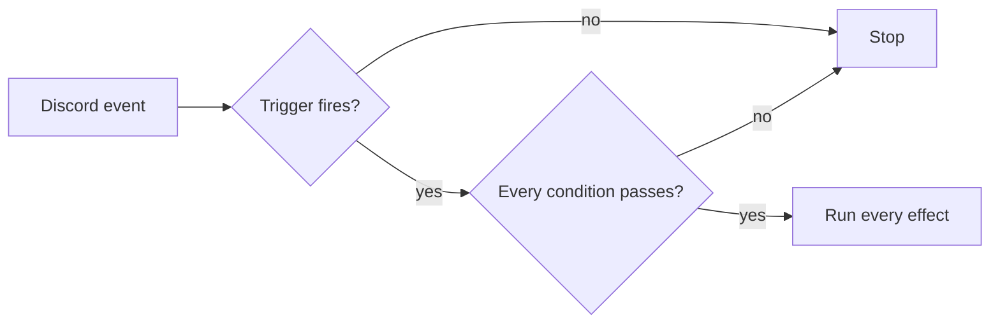

# Advanced Automoderator

A rule-based moderation engine for the Parrot Discord bot. Every rule answers three questions:

- **What am I looking for?** One **trigger**.
- **Does it apply here, and to this person?** Zero or more **conditions**.
- **What should happen?** One or more **effects** (up to 15).

Rules are independent. There are no rulesets: build several small rules and let them cooperate through violations.



## Contents

- [Status](#status)
- [Package layout](#package-layout)
- [Using it in Discord](#using-it-in-discord)
- [Concepts](#concepts)
- [Rule format](#rule-format)
- [Integration guide](#integration-guide)
- [Behavior reference](#behavior-reference)
- [Limits](#limits)
- [Testing](#testing)
- [Known gaps](#known-gaps)
- [Extending](#extending)
- [Troubleshooting](#troubleshooting)

## Using it in Discord

| Command | What it does |
|---|---|
| `/automod add <name>` | Opens the builder for a new rule. |
| `/automod edit <name>` | Reopens an existing rule in the builder. The name autocompletes. |
| `/automod delete <name>` | Deletes a rule after a confirmation. |
| `/automod list` | Browses rules, five per page, highest priority first. |

All four require **Manage Server** by default. Server admins can change that under *Server Settings → Integrations*.

The builder is one message showing the whole rule: settings, trigger, conditions and effects.

- The card is **orange** while the rule is incomplete and **green** once it can be saved.
- **Save** stays disabled until the rule has a trigger and at least one effect.
- **Settings** edits the name, priority and enabled flag.
- Adding a trigger, condition or effect is two clicks: pick a group, pick an item. Items with options open a form. Forms are validated before anything is added.
- Durations accept `30m`, `12h`, `7d`, `2w` and combinations such as `1d 12h`.

A condition type appears once per rule. Adding it again replaces the old settings, and conflicting pairs replace each other (see [Conditions](#conditions)).

## Concepts

### Events

Each trigger belongs to exactly one event type. The engine must evaluate a rule only on its own event (`trigger.event`).

| Event | Subject | Triggers |
|---|---|---|
| `MESSAGE` | `message=` | Everything in the message, link, word and rate-limit groups |
| `MEMBER_JOIN` | `member=` | `new_member`, `join_username_*` |
| `NICKNAME_CHANGE` | `member=` | `nickname_*` |
| `VIOLATION` | `member=` | `violations`, `x_violation_in_y_minutes` |

### Triggers

Config keys and bounds are what the parser enforces.

| Group | Trigger values | Config |
|---|---|---|
| Content | `all_caps` | `min_count` (letters), `percentage` (0 to 100) |
| | `message_mentions` | `count` (at least 1) |
| | `message_length_gt`, `message_length_lt` | `length` |
| | `message_regex`, `message_not_regex` | `regex` |
| | `message_with_attachments`, `message_without_attachments`, `any_link`, `server_invites`, `flagged_scam_links`, `discord_automod` | none |
| Lists | `word_denylist`, `word_allowlist`, `website_denylist`, `website_allowlist` | `list` (list name, optional) |
| User rate limits | `x_message_in_y_minutes`, `x_user_links_in_y_minutes`, `user_attachments`, `x_user_message_mentions_in_y_minutes`, `x_consecutive_identical_messages` | `count`, `within_minutes` |
| Channel rate limits | `x_channel_message_in_y_minutes`, `x_channel_links_in_y_minutes`, `channel_attachments`, `x_channel_message_mentions_in_y_minutes` | `count`, `within_minutes` |
| Nickname | `nickname_regex`, `nickname_not_regex` | `regex` |
| | `nickname_word_allowlist`, `nickname_word_denylist` | `list` |
| Join | `new_member`, `join_username_invite` | none |
| | `join_username_regex`, `join_username_not_regex` | `regex` |
| | `join_username_word_allowlist`, `join_username_word_denylist` | `list` |
| Violations | `violations` | `violation_name`, `number_of_violations`, `within_minutes` |
| | `x_violation_in_y_minutes` | `count`, `within_minutes` |

### Conditions

Every condition must pass. There is no OR: make two rules instead. A condition can only narrow a rule, never widen it.

| Condition values | Config | Passes when |
|---|---|---|
| `ignored_roles` | `roles`, up to 25 | The user has none of the roles |
| `required_roles` | `roles`, `require_all` | The user has any (or all) of the roles |
| `ignored_channels`, `active_channels` | `channels` | The channel is not in the list, or is in it |
| `ignored_categories`, `active_categories` | `categories` | Same, for the channel's category |
| `account_age_above`, `account_age_below` | `minutes` | The Discord account is older or newer than that |
| `member_duration_above`, `member_duration_below` | `minutes` | Time in this server is longer or shorter than that |
| `ignore_bots`, `only_bots` | none | The author is not a bot, or is one |
| `new_message`, `edited_message` | none | The message is new, or was edited |
| `active_in_threads`, `ignore_threads` | none | The message is in a thread, or is not |
| `ignore_forwards`, `only_forwards` | none | The message has no forwarded content, or has it |

Conflicting pairs replace each other when added: `ignore_bots` and `only_bots`, `new_message` and `edited_message`, `active_in_threads` and `ignore_threads`, `ignore_forwards` and `only_forwards`.

### Effects

All effects in a rule run. Kick and ban always run last; everything else runs in the listed order.

| Effect | Config | Bot permission |
|---|---|---|
| `delete_message` | none | Manage Messages |
| `delete_multiple_messages` | `count`, `max_age_seconds` | Manage Messages, Read Message History |
| `add_violation` | `name` (optional) | none |
| `reset_violations` | `name` (optional) | none |
| `warn_user` | `message` (optional) | none |
| `timeout_user` | `duration_minutes`, `message` | Moderate Members |
| `mute_user` | `duration_minutes`, `message` | Depends on your mute implementation |
| `kick_user` | `message` | Kick Members |
| `ban_user` | `duration_minutes`, `delete_days`, `message` | Ban Members |
| `set_nickname` | `nickname` (empty clears) | Manage Nicknames |
| `give_role`, `remove_role` | `role_id`, `duration_seconds` | Manage Roles |
| `enable_slowmode` | `duration_seconds`, `ratelimit_seconds` | Manage Channels (Manage Threads in threads) |
| `send_message` | `message`, `delete_after_seconds`, `ping_user`, `channel_id` | View Channel, Send Messages |
| `send_alert` | `message`, `channel_id` | View Channel, Send Messages, Embed Links |

These effects can be added more than once with different settings: `add_violation`, `reset_violations`, `give_role`, `remove_role`, `send_message`, `send_alert`. `kick_user` and `ban_user` replace each other, and so do `mute_user` and `timeout_user`.

## Rule format

```json
{
  "name": "links-strike",
  "priority": 0,
  "enabled": true,
  "trigger": {
    "type": "any_link"
  },
  "conditions": [
    {"type": "active_channels", "config": {"channels": [333333333333333333]}},
    {"type": "ignored_roles", "config": {"roles": [111111111111111111]}}
  ],
  "effects": [
    {"type": "delete_message"},
    {"type": "add_violation", "config": {"name": "links"}},
    {
      "type": "send_message",
      "config": {
        "message": "{user}, links aren't allowed here.",
        "delete_after_seconds": 10,
        "ping_user": true
      }
    }
  ]
}
```

- `config` may be omitted when every key is optional. Types whose config has required keys must supply it.
- Unknown keys are ignored.
- `priority` and `enabled` are optional (defaults `0` and `true`). Higher priority is evaluated first.
- Parsing is strict about types: booleans are not integers, strings are not integers, ID lists must be JSON arrays of non-negative integers.

Parse a rule yourself:

```python
rule = Rule(
    name=data["name"],
    trigger=Trigger.parse(data["trigger"]),
    conditions=[Condition.parse(item) for item in data["conditions"]],
    effects=[Effect.parse(item) for item in data["effects"]],
    enabled=data.get("enabled", True),
    priority=data.get("priority", 0),
)
```

Errors raise `TriggerParseError`, `ConditionParseError` or `EffectParseError`. Constructing `Trigger`, `Condition` or `Effect` directly with the wrong config class raises `TypeError`.

### Effect message placeholders

Every message text (warn, kick, ban, mute, timeout, send message, alert) supports:

| Placeholder | Replaced with |
|---|---|
| `{user}` | A mention of the user |
| `{user.name}` | The username |
| `{user.id}` | The user ID |
| `{server}` | The server name |
| `{channel}` | A mention of the channel (empty on events without a message) |
| `{rule}` | The rule name |

## Behavior reference

### Triggers

- **Comparisons.** Lengths use strict `>` and `<`. `message_mentions` and every rate limit use `>=`, so "3 messages in 1 minute" fires on the third.
- **All caps.** Only cased letters count, after stripping links, mentions, custom emoji, timestamps and code. `min_count` is a letter count. The percentage test uses integer math, so 100 means every letter.
- **Mentions.** Only typed `<@id>` user mentions count. Replies, roles, `@everyone` and self-mentions are excluded. Each user counts once.
- **Links.** Only `http(s)://` and `www.` links are detected. Domain lists match the domain and all its subdomains.
- **Words.** Text is normalized (NFKC, case-folded) and split on anything that is not a letter or digit. Entries are single words.
- **Regexes.** RE2 syntax, case-sensitive unless you add `(?i)`. An invalid pattern never fires.
- **Missing nickname.** Every nickname trigger returns `False`, including `nickname_not_regex`.
- **Lists.** A trigger with no list name or an unknown list never fires. Denylists need an entry to match. Allowlists fire on anything not listed, so an empty allowlist fires on everything.
- **`env` required.** Word and website lists, scam links, Discord AutoMod, rate limits and violations need an env. Without one, `check` raises `TriggerEnvError`.

### Rate limits

Rate limits use discord.py's `CooldownMapping` as a **fixed window** that starts at the first event and never moves.

- The `count`-th event inside a window fires, and every later one fires until the window ends.
- A burst that straddles a window boundary can be missed. Slow, steady traffic never fires (one message a minute never trips "3 per minute").
- Only the message that carries the offending unit fires. A message with no links neither counts nor fires a link limit.
- Counters live in memory and reset on restart.
- Each call scans the live buckets of its mapping, so cost grows with active users: about 50 µs at 1,000, 300 µs at 5,000 and 1 ms at 20,000 live buckets. Keep windows short on very large servers.
- `x_consecutive_identical_messages` resets whenever a user sends a different message.
- The smallest window is one minute.

### Conditions

- **No message (join, nickname, violation events).** Exclusions pass and requirements fail. `ignored_channels`, `ignored_categories`, `ignore_threads` and `ignore_forwards` pass. `active_channels`, `active_categories`, `active_in_threads`, `only_forwards`, `new_message` and `edited_message` fail.
- **Empty lists.** An empty ignore list passes everyone. An empty required or active list fails everyone, including `require_all`.
- **Threads** count as their parent channel and the parent's category. A config that lists the thread's own ID also matches.
- **Non-member authors** (webhooks, users who left) have no roles, so `ignored_roles` passes and `required_roles` fails. Member duration is unknown, so both duration conditions fail. Account age still works.
- **Ages** use strict comparisons. An age exactly equal to the limit matches neither "above" nor "below".
- **`edited=`** overrides `message.edited_at` when you know better.

### Effects

- **Never raises.** Missing permissions, role hierarchy, the server owner, the bot itself and missing targets produce a `skipped` outcome with a reason. Discord errors produce `failed`. A failing effect never stops the others.
- **DMs.** The DM is sent before kick, ban, mute and timeout. Closed DMs don't block the punishment. `warn_user` is skipped if its DM can't be delivered. Only `warn_user` has a default text. The others DM only when a message is set.
- **Mentions.** `send_message` can ping only the user, and only when *Ping the user* is on. `@everyone` and role mentions in your text never ping. Alerts ping nobody.
- **Targets.** Member effects need a server member. Message effects need a message. On join, nickname and violation events, `send_message` and `send_alert` need an explicit channel.
- **Timeout.** Capped just under 28 days. Skipped for administrators and when a longer timeout is already active.
- **Slowmode** never loosens an existing delay. The restore timer is created only when the bot changed something, and does nothing if the delay changed meanwhile.
- **Roles.** A timed role change is scheduled only if the bot changed the member's roles, so repeated firings don't stack timers. Managed roles, `@everyone` and roles at or above the bot's top role are skipped.
- **Bulk delete** scans at most 300 messages, newest first, and deletes up to `count` of the offender's messages. The window is clamped to under 14 days.
- **Violations.** `add_violation` dispatches `automod_violation`. A rule that adds a violation of the name it triggers on loops.

## Limits

| Item | Limit |
|---|---|
| Rule name | 1 to 100 characters |
| Effects per rule | 15 |
| Triggers per rule | 1 |
| Conditions per rule | 1 per condition type |
| Roles, channels or categories per condition | 25 |
| Regex pattern | 500 characters |
| Warn, kick, ban, mute, timeout, send message, alert text | 1000 characters |
| Nickname | 32 characters |
| Violation and list names | 100 characters |
| Counts and lengths in forms | up to 99999 |
| Rate-limit window and condition durations | 1 minute or more |
| Timeout | 1 minute to 28 days |
| Slowmode delay | 1 second to 6 hours |
| Bulk delete | 1 to 100 messages |
| Ban message history | 0 to 7 days |

The builder enforces these. The parser enforces types and the minimums listed under [Concepts](#concepts); see [Known gaps](#known-gaps).
